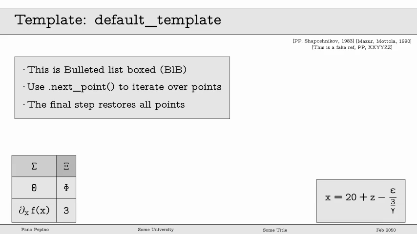
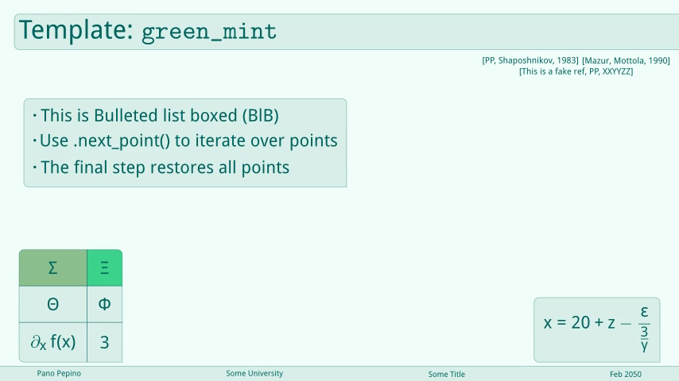
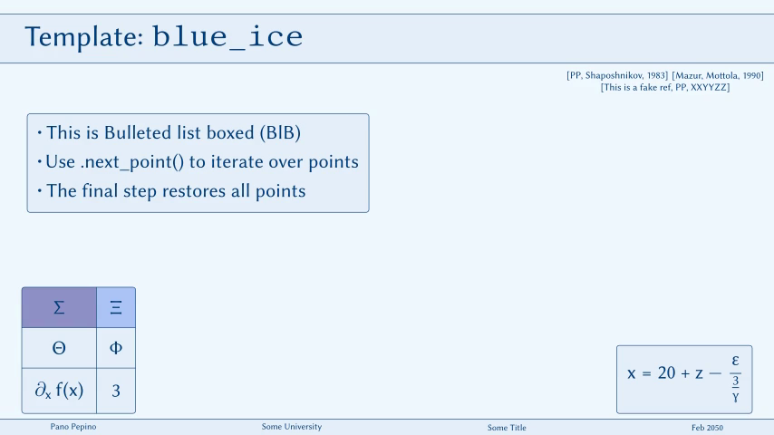
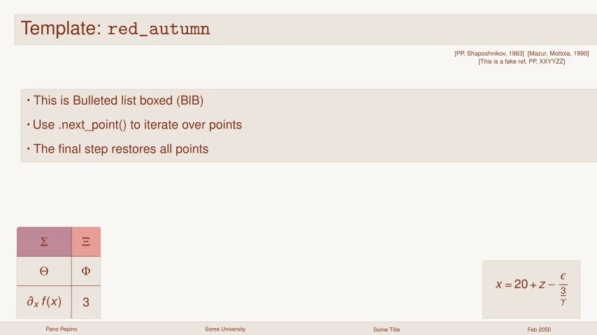
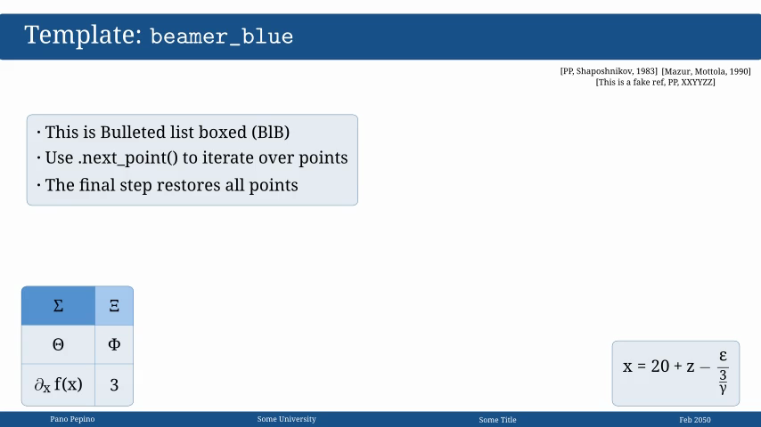
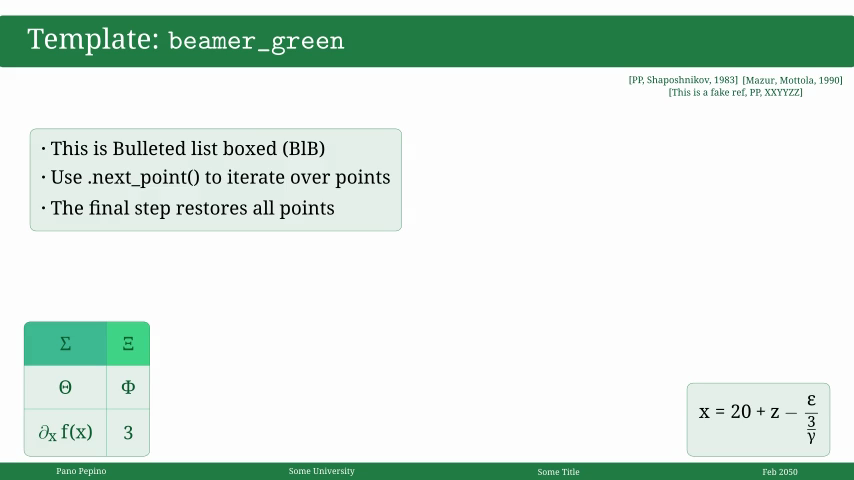
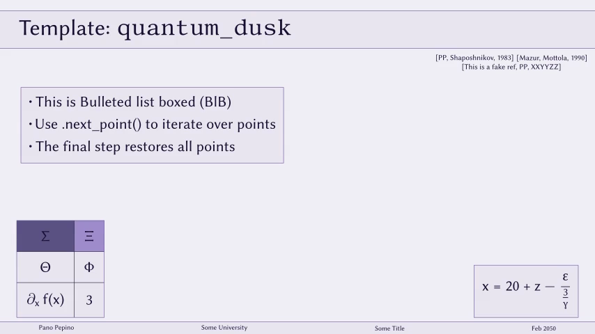
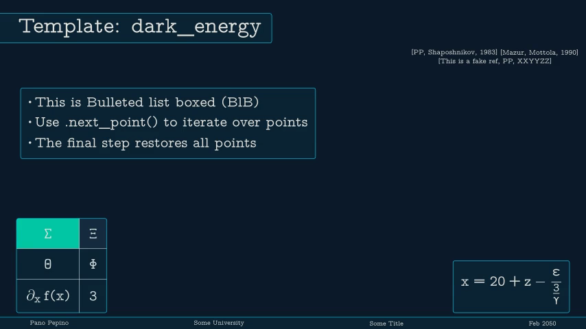

<div align="center">

# Beanim

**Beamer-vibes library for creating beautiful Manim presentation slides**

<a href="https://www.buymeacoffee.com/panopepino" target="_blank">
  
</a>

[Documentation](https://panopepino.github.io/beanim/) • [Examples](#examples) • [Installation](#installation)

</div>


## 📖 About Beanim

This repository contains v2.2 of **beanim** (Beamer + Manim) libraries. This package aims to offer a similar experience to that of Beamer in LaTeX, by offering familiar properties in Manim + ManimSlides to the slides created by Beamer.

While the package is currently quite limited, the idea is to improve and expand through collaboration with other people interested in enhancing the package.

> **⚠️ Important Note**  
> The package will be displayed in pip as **manim_beanim**. This is also the way to import the package in the preamble of your Python files. However, documentation and webpage will keep the name as **beanim** for simplicity.


## 🎥 Example Presentation

Here's a complete presentation created with Beanim demonstrating all the main features:

<div align="center">
  <a href="https://panopepino.github.io/web_page/main_page/presentations/2025_06_jsps/jsps_slide.html" target="_blank">
    
  </a>
</div>


<sub>*Click the button above to view the interactive presentation in a new tab*</sub>


## Examples

Here you can find an overview of the current templates and how almost all objects look like in each template.

### 🎨 Template Gallery

<div align="center">

| Template | Preview |
|:--------:|:-------------:|
| 🎨 **default_template** |  |
| 🌿 **green_mint** |  |
| 🧊 **blue_ice** |  |
| 🍂 **red_autumn** |  |
| 🔵 **beamer_blue** |  |
| 🟢 **beamer_green** |  |
| 🌌 **quantum_dusk** |  |
| ⚫ **dark_energy** |  |

</div>


### Installation

In order to **install** this library, do the following:

```bash
git clone https://github.com/PanoPepino/beanim

python -m pip install ./beanim
```

- To **use** with in your manim files, call it with:

```python
from manim_beanim import *
```


For detailed usage instructions and API reference, visit the [📚 documentation](https://panopepino.github.io/beanim/).


## Future Features

The following features are planned for future versions:

- 🎨 **Multiple Templates**: More templates.
- 📊 **Plot Support**: Generic plot creation with data input (in development).
- 🔢 **Equation Handling**: Refer to your equations as you do in your LaTeX articles (i.e. \ref{your_label})
- ✨ **Animation Methods**: Sliding titles, delayed backgrounds, and more..
- 🎯 **Beamer-like Experience**: More Beamer like features to come.

## 💖 Support My Work

If you find this project helpful, consider supporting its development. Thank you!

<p align="center">
  <a href="https://www.buymeacoffee.com/panopepino" target="_blank">
    
  </a>
</p>


<!--
---Log of changes---

2025/12/02: - Added multi_template.py file to directly craft all templates without effort

2025/11/26: - Changed import_template to import_template_beanim
            - Added 2 new templates inspired by AI
            - Modified README and examples.rst to accomodate changes.

-->


<!-- ## TO DO

(Collaboration is welcomed!!)

- Add personal research equations and references. Ignore with .git. [_]
- To create Plot_General (Modify so that it behaves like Eq_General, i.e. data_base, dictionary or manual input) [_]
    - Inputs should be axis labels, length and plots. [_]
    - Possible methods: 
        - FadeIn axis [_]
        - Draw plot with iterator [_]
- If possible, make the equation number of the paper the key of the dictionary for Equation. [_]
- More templates. Always more templates. [_]
- Extra features to Title_Section and similar (underbar, different color for first Capital letter, etc.) [_]
- Extra animation methods (Sliding Title_Section + delayed background, etc..) [_]
-->

## Theme application

Use `apply_theme("blue_ice")` before creating objects, or
`apply_theme("blue_ice", scene=self)` inside an existing scene to update its background.
Theme selection applies to future Beanim components and ordinary Manim text.
Existing objects keep their appearance; explicit constructor styling overrides presets.
`import_template_beanim()` and legacy import paths remain supported.

Dictionary sources support JSON, existing Python-literal `.txt` files, pathlib paths,
and mappings. Input dictionaries never execute Python code.

Run regression checks with `python -m unittest discover -s tests -v`.

## Documentation deployment

GitHub Pages publishes Sphinx/Furo documentation after package checks pass.
Set repository **Settings → Pages → Source** to **GitHub Actions**.
The workflow verifies styles, gallery images, API links, legacy redirects,
and deployed commit identity. Push to `main` to trigger it.

Only eight curated template screenshots are published. Generated videos,
TeX files and intermediate renders stay local.
Refresh screenshots with `python scripts/refresh_gallery.py`.

Build and validate locally with Python 3.12 or newer (required by pinned Sphinx 9.1):

```bash
python -m pip install -c docs/requirements.txt ".[docs]"
python -m sphinx -E -a -W --keep-going -d docs/_build/doctrees -b html docs docs/_build/html
python scripts/prepare_docs.py docs/_build/html --sha "$(git rev-parse HEAD)"
python scripts/verify_docs.py --artifact docs/_build/html --sha "$(git rev-parse HEAD)"
python -m http.server 8000 --directory docs/_build/html
```

Open http://localhost:8000/. Commit and push remain manual.
